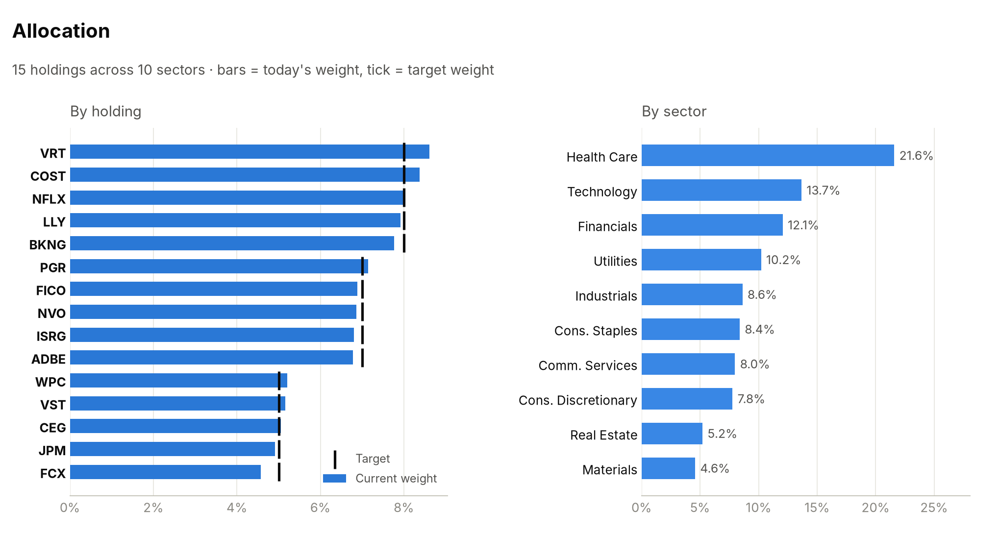
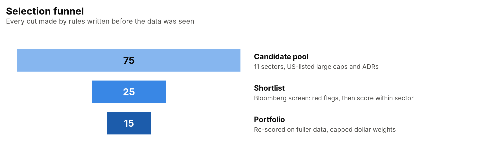
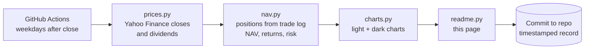

<div align="center">

# 15-Stock Rules-Based Fund

**A $100, 15-stock US equity fund picked by written rules from Bloomberg data, tracked daily against the S&P 500 Total Return.**

[](https://github.com/robcarlson006/15-stock-fund/actions/workflows/daily-update.yml)    

</div>

## Performance

| NAV | Since inception | S&P 500 Total Return | Excess return | Last session |
|:--:|:--:|:--:|:--:|:--:|
| **$94.37** | **−6.10%** | −5.07% | **−1.03 pts** | −1.45% vs −2.01% |

| Max drawdown | Volatility | Sharpe | Beta | Tracking error | Days beating index | Dividends | Days tracked |
|:--:|:--:|:--:|:--:|:--:|:--:|:--:|:--:|
| −6.10% | _after 5 days_ | _20d+_ | _20d+_ | _20d+_ | 50% | $0.01 | 5 |

<picture>
  <source media="(prefers-color-scheme: dark)" srcset="assets/charts/performance-dark.png">
  
</picture>

<sub>Updated automatically after every US market close. Time-weighted returns, dividends included; benchmark is the S&P 500 Total Return index (^SP500TR). Data as of 19 Nov 2026.</sub>

## Holdings

| | Ticker | Company | Sector | Weight | Target | Price | Return | P&L |
|--:|:--|:--|:--|--:|--:|--:|--:|--:|
| 1 | **VRT** | Vertiv | Industrials | 8.6% | 8% | $194.48 | +1.6% | +$0.13 |
| 2 | **COST** | Costco | Cons. Staples | 8.4% | 8% | $1,093.83 | −1.2% | −$0.10 |
| 3 | **NFLX** | Netflix | Comm. Services | 8.0% | 8% | $58.46 | −5.9% | −$0.48 |
| 4 | **LLY** | Eli Lilly | Health Care | 7.9% | 8% | $1,351.12 | −6.5% | −$0.52 |
| 5 | **BKNG** | Booking Holdings | Cons. Discretionary | 7.8% | 8% | $147.32 | −8.5% | −$0.68 |
| 6 | **PGR** | Progressive | Financials | 7.1% | 7% | $229.96 | −3.7% | −$0.26 |
| 7 | **FICO** | Fair Isaac | Technology | 6.9% | 7% | $677.64 | −7.2% | −$0.50 |
| 8 | **NVO** | Novo Nordisk (ADR) | Health Care | 6.9% | 7% | $38.87 | −7.5% | −$0.52 |
| 9 | **ISRG** | Intuitive Surgical | Health Care | 6.8% | 7% | $407.24 | −8.4% | −$0.59 |
| 10 | **ADBE** | Adobe | Technology | 6.8% | 7% | $221.68 | −8.7% | −$0.61 |
| 11 | **WPC** | W. P. Carey | Real Estate | 5.2% | 5% | $65.16 | −1.7% | −$0.09 |
| 12 | **VST** | Vistra | Utilities | 5.2% | 5% | $125.58 | −2.7% | −$0.14 |
| 13 | **CEG** | Constellation Energy | Utilities | 5.0% | 5% | $262.74 | −4.9% | −$0.25 |
| 14 | **JPM** | JPMorgan Chase | Financials | 4.9% | 5% | $320.22 | −7.3% | −$0.37 |
| 15 | **FCX** | Freeport-McMoRan | Materials | 4.6% | 5% | $49.12 | −13.8% | −$0.69 |

<picture>
  <source media="(prefers-color-scheme: dark)" srcset="assets/charts/holdings-dark.png">
  
</picture>

<picture>
  <source media="(prefers-color-scheme: dark)" srcset="assets/charts/allocation-dark.png">
  
</picture>

<picture>
  <source media="(prefers-color-scheme: dark)" srcset="assets/charts/drawdown-dark.png">
  
</picture>

## How the 15 were picked

<picture>
  <source media="(prefers-color-scheme: dark)" srcset="assets/charts/funnel-dark.png">
  
</picture>

The fund was built the way an institutional fund is: **rules first, then data, then picks, then sizing.** Every rule was written down before any company was scored, and every change is dated in the [decision log](journal/decision-log.md).

| Stage | What happened | Output |
|:--|:--|:--|
| **0. Policy** | Wrote the investment policy (1-year horizon, S&P 500 Total Return benchmark, monthly review) and the scoring rules | [Investment policy](02_policy/investment-policy-statement.md) · [Scoring framework](03_methodology/scoring-framework.md) |
| **1. 75 → 25** | Pulled a Bloomberg financial-analysis report for all 75 on one day, parsed them with Python, removed red flags, then scored each company **against its own sector** on quality, value, balance sheet and growth | [Shortlist memo](analysis/stage1_75_to_25/shortlist_25.md) |
| **2. 25 → 15** | Pulled fuller Bloomberg data, re-scored (Piotroski F-score, earnings-beat record, consensus growth, cash yield after stock pay), ran robustness checks on the weights, applied sector and theme limits | [Investment committee memo](analysis/stage2_25_to_15/final_15.md) |
| **3. Sizing** | Tiered dollar weights ($8 / $7 / $5) with position and sector caps, checked by script | [Target allocation](portfolio/target_allocation.csv) |
| **4. Run it** | Daily tracking (this page) and a monthly review against written sell triggers | [Monthly journal](journal/monthly/) |

Every holding has a one-line thesis and a **written sell trigger** set before purchase, in [`target_allocation.csv`](portfolio/target_allocation.csv).

## How the tracking works



- **Schedule:** every weekday at 21:30 UTC (4:30 pm New York in winter, 5:30 pm in summer), after the close. Market holidays add no row.
- **Positions:** rebuilt each run from [`portfolio/trade_log.csv`](portfolio/trade_log.csv), so a new trade only needs one line in that file.
- **Returns:** fund and index are both measured from the inception-day close, then time-weighted (new money is not counted as performance). P&L per holding is measured from the actual fill price. Dividends are credited on the ex-date as an estimate of cash the broker pays on the pay date.
- **Data files:** [`tracking/nav.csv`](tracking/nav.csv) (daily NAV and index levels), [`tracking/prices.csv`](tracking/prices.csv), [`tracking/holdings.csv`](tracking/holdings.csv), [`tracking/summary.json`](tracking/summary.json).
- **Audit trail:** each daily commit is a timestamped record of the portfolio, so the track record can't be backfilled or edited after the fact without it showing in the history.

## Repository layout

```
02_policy/          investment policy statement
03_methodology/     scoring rules for every stage
analysis/           Stage 1 and Stage 2 scores, robustness checks, memos
portfolio/          target allocation and trade log
journal/            decision log and monthly reviews
tracking/           daily prices, NAV, holdings, summary (auto-updated)
assets/charts/      README charts (auto-updated)
tools/              Python: Bloomberg extraction, scoring, sizing, daily tracker
```

---

<sub>Educational project with real money ($100). Picks are the output of written rules, not investment advice. Raw Bloomberg exports are not redistributed in this repository. Prices from Yahoo Finance; small differences from broker prices are expected.</sub>
